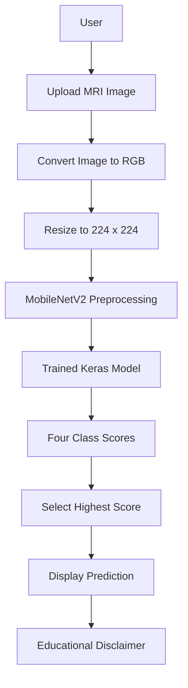

# 🧠 Brain Tumor MRI Classifier

### Deep Learning · Transfer Learning · Streamlit

An educational brain MRI image-classification application powered by **MobileNetV2, TensorFlow/Keras, and Streamlit**.


> **Medical disclaimer:** This is an educational and research prototype, not a medical device. It must not be used to diagnose diseases or make treatment decisions. Always consult qualified medical professionals.

---

## 📌 Table of Contents

- [Overview](#-overview)
- [Features](#-features)
- [Supported Classes](#-supported-classes)
- [Technology Stack](#-technology-stack)
- [System Architecture](#-system-architecture)
- [Model Performance](#-model-performance)
- [Installation](#-installation)
- [Run the Application](#-run-the-application)
- [Project Structure](#-project-structure)
- [Deployment](#-deployment)
- [Future Improvements](#-future-improvements)
- [Limitations](#-limitations)
- [Disclaimer](#-disclaimer)

## 🚀 Overview

Brain Tumor MRI Classifier is a computer-vision project that demonstrates how deep learning can classify brain MRI images into four dataset categories. It uses a trained MobileNetV2 model and a Streamlit interface to accept an image, generate class scores, and display the predicted category.

The project covers the machine-learning workflow, including image preprocessing, model training and comparison, evaluation, model saving, and interactive inference.

### Project Highlights

| Component | Description |
|---|---|
| Problem | Four-class brain MRI image classification |
| Selected model | MobileNetV2 |
| Learning approach | Transfer learning |
| Input | JPG, JPEG, or PNG image |
| Image size | 224 × 224 pixels |
| Output | Predicted dataset class and class scores |
| Test-set size | 246 images |
| Reported test accuracy | **90.24%** |
| Interface | Streamlit web application |

## ✨ Features

- 🖼️ Upload brain MRI images through a simple web interface.
- 🧠 Predict one of four dataset classes.
- 📊 Display class-wise model probability scores.
- ⚡ Cache the loaded model for repeated predictions.
- 🛠️ Handle image-processing and model-loading errors.
- 🌐 Run locally and prepare for web deployment.
- 📋 Compare multiple model architectures using evaluation metrics.

## 🧬 Supported Classes

| Dataset label | Display name |
|---|---|
| `glioma` | Glioma |
| `meningioma` | Meningioma |
| `no_tumor` | No tumour |
| `pituitary` | Pituitary |

These are dataset labels, not confirmed medical findings.

## 🧰 Technology Stack

- **Python** — application logic
- **TensorFlow / Keras** — model loading and inference
- **MobileNetV2** — transfer-learning architecture
- **NumPy** — numerical operations
- **Pillow** — image loading and conversion
- **Streamlit** — interactive web interface
- **Git and GitHub** — version control and project hosting

## 🏗️ System Architecture



### Prediction Workflow

1. The user uploads an image.
2. The application converts it to RGB format.
3. The image is resized to 224 × 224 pixels.
4. MobileNetV2 preprocessing is applied.
5. The trained model generates scores for all four classes.
6. The class with the highest score is displayed as the prediction.

The scores represent model outputs and are not necessarily calibrated clinical probabilities.

## 📊 Model Performance

The following results were obtained during evaluation on the project's held-out test set of 246 images.

| Model | Test Accuracy | Weighted Precision | Weighted Recall | Weighted F1-score |
|---|---:|---:|---:|---:|
| Custom CNN | 32.93% | 12.78% | 32.93% | 17.32% |
| **MobileNetV2** | **90.24%** | **90.33%** | **90.24%** | **90.27%** |
| EfficientNetB0 | 89.84% | 89.71% | 89.84% | 89.66% |
| EfficientNetB0 Fine-tuned | 89.84% | 89.71% | 89.84% | 89.66% |

### Why MobileNetV2?

MobileNetV2 achieved the strongest validation weighted F1-score and the highest test accuracy and weighted F1-score among the evaluated model configurations. It was therefore selected for the Streamlit application.

### MobileNetV2 Class-wise Results

| Class | Precision | Recall | F1-score | Test images |
|---|---:|---:|---:|---:|
| Glioma | 93.59% | 91.25% | 92.41% | 80 |
| Meningioma | 81.54% | 84.13% | 82.81% | 63 |
| No tumour | 91.67% | 89.80% | 90.72% | 49 |
| Pituitary | 94.55% | 96.30% | 95.41% | 54 |

**Metric interpretation:**

- **Accuracy:** proportion of test images classified correctly.
- **Precision:** reliability of the model's predictions for a class.
- **Recall:** proportion of actual examples of a class identified correctly.
- **F1-score:** balance between precision and recall.

These results apply to this particular dataset and split. They do not establish clinical reliability or guarantee performance on external MRI images.

## ⚙️ Installation

### Prerequisites

- Python installed on your computer
- Visual Studio Code (recommended)
- The project files, including the trained model

### 1. Clone the repository

```bash
git clone https://github.com/YOUR-USERNAME/brain-tumor-mri-classifier.git
cd brain-tumor-mri-classifier
```

Replace `YOUR-USERNAME` with your GitHub username.

### 2. Create a virtual environment

**Windows PowerShell:**

```powershell
python -m venv .venv
.\.venv\Scripts\Activate.ps1
```

### 3. Install dependencies

```powershell
python -m pip install -r requirements.txt
```

## ▶️ Run the Application

Start Streamlit:

```powershell
python -m streamlit run app.py
```

Open the local URL shown in the terminal, typically:

```text
http://localhost:8501
```

Ensure `best_brain_tumor_mobilenetv2.keras` is placed beside `app.py`.

## 📁 Project Structure

```text
BrainTumorClassifier/
├── app.py
├── requirements.txt
├── README.md
└── best_brain_tumor_mobilenetv2.keras
```

The trained model is required for predictions. The training, validation, and test image folders are not required to run the application because the saved model contains the learned parameters.

## 🌐 Deployment

The application can be prepared for deployment using Streamlit Community Cloud.

1. Push the application code, dependency file, README, and trained model to GitHub.
2. Sign in to Streamlit Community Cloud using GitHub.
3. Create an app and select the repository, branch, and `app.py` entry point.
4. Wait for the deployment to finish.
5. Test the deployed URL with permitted sample images.

**Live application:** _Add your deployed URL here after deployment._

## 🔮 Future Improvements

- Add a confusion matrix and evaluation dashboard to the interface.
- Investigate weaker class-wise results, particularly meningioma recall.
- Evaluate on an independent external dataset.
- Improve uncertainty handling and probability calibration.
- Add automated tests for preprocessing and predictions.
- Pin tested dependency versions for reproducible deployment.
- Add screenshots and a demo video.
- Explore explainability visualisations such as occlusion sensitivity.

## ⚠️ Limitations

- Results are based on a limited dataset and one held-out test split.
- Generalisation to external hospitals, scanners, and populations has not been established.
- Incorrect predictions can occur, including predictions with high model scores.
- Model scores are not a substitute for professional medical interpretation.
- Clinical deployment would require extensive independent validation and appropriate regulatory review.

## 🩺 Disclaimer

This project is intended strictly for educational and research purposes. It is not designed or validated for clinical diagnosis, treatment, triage, or patient-management decisions. Do not use its output to make medical decisions.

## 🙌 Acknowledgements

Thanks to the developers and communities behind TensorFlow, Keras, MobileNetV2, Streamlit, and the dataset used for experimentation. Follow the dataset provider's attribution and usage terms when redistributing project materials.

---

<div align="center">

**Built for learning. Evaluated with metrics. Shared responsibly.**

</div>
